<div align="center">

# SmartScan

**Document scanner and PDF toolkit for Android: scan, extract text, compress, merge, split and convert, all on the device.**

[](https://play.google.com/store/apps/details?id=com.channabandara.smartscan)


-orange)


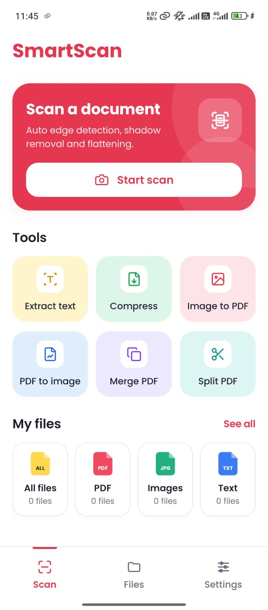
&nbsp;&nbsp;
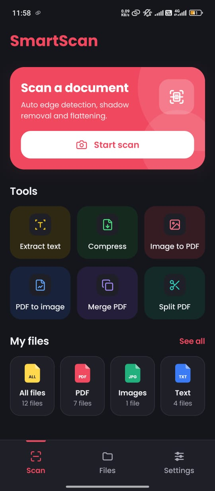

</div>

---

## About

SmartScan turns a phone into a pocket scanner and PDF workshop. You point the camera at a page, and the app finds the edges, flattens the page and removes shadows to give you a clean PDF. The same app also has six document tools.

It was built around one rule: **your documents never leave your phone.** All processing happens on the device. There is no account, no cloud upload and no runtime permissions.

**Contents:** [Scanning](#scanning) · [Tools](#six-document-tools) · [Files and settings](#files-settings-and-themes) · [Privacy](#privacy-by-design) · [Engineering](#engineering-highlights) · [Tech stack](#tech-stack) · [Architecture](#architecture) · [Versions](#version-history)

---

## Scanning

The camera work is handled by Google's system document scanner. SmartScan saves the result as a PDF and opens it, ready for the next step. Photos already in the gallery can be cleaned up the same way.

<table>
  <tr>
    <td align="center" width="25%">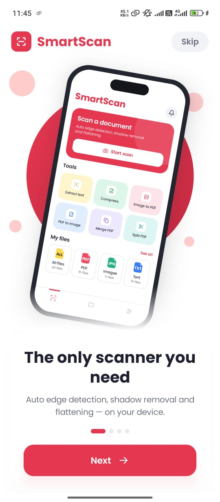<br /><b>1. First launch</b><br /><sub>A short walkthrough that can be skipped</sub></td>
    <td align="center" width="25%"><br /><b>2. Start a scan</b><br /><sub>The main action on the home screen</sub></td>
    <td align="center" width="25%">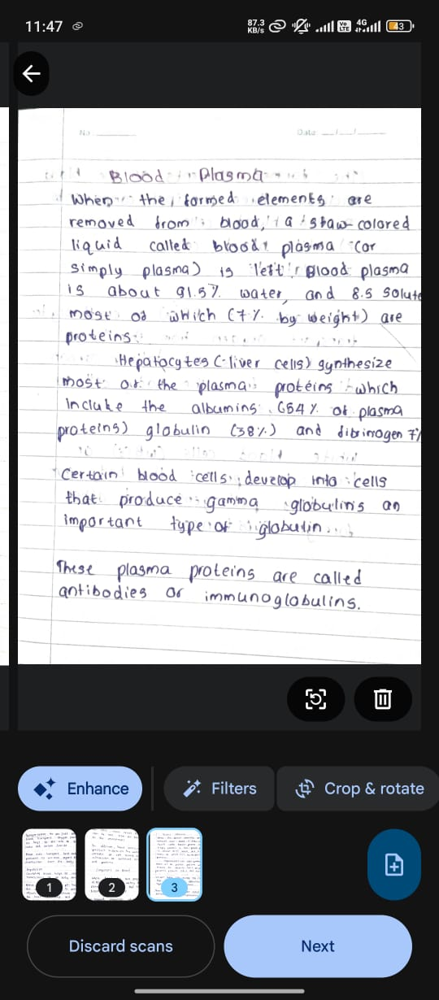<br /><b>3. Review the pages</b><br /><sub>Enhance, filter, crop and add pages in Google's scanner</sub></td>
    <td align="center" width="25%">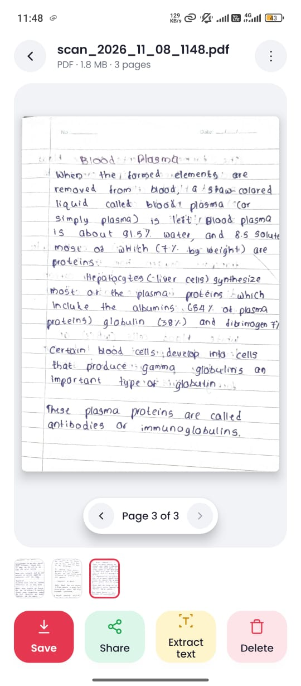<br /><b>4. Use the PDF</b><br /><sub>Save, share or extract text</sub></td>
  </tr>
</table>

---

## Six document tools

| Tool | What it does |
|---|---|
| **Extract text** | Reads text from images and PDFs in reading order, so multi-column pages come out correctly. Supports batch extraction, English and other Latin-alphabet languages. |
| **Compress** | Shrinks PDFs and images, with quality levels and JPG, PNG or WebP output. Supports batch compression. |
| **Image to PDF** | Turns one or many photos into a single PDF, with page-size and quality options. |
| **PDF to image** | Exports every page of a PDF as a high-resolution image. |
| **Merge PDF** | Combines several PDFs into one, in the order you choose. |
| **Split PDF** | Pulls the pages you select out into a new PDF. |

### Extract text

In this test run, a 6-page PDF produced 2,496 words in 0.5 seconds. The text can be copied, shared or saved as a `.txt` file.

<table>
  <tr>
    <td align="center" width="33%">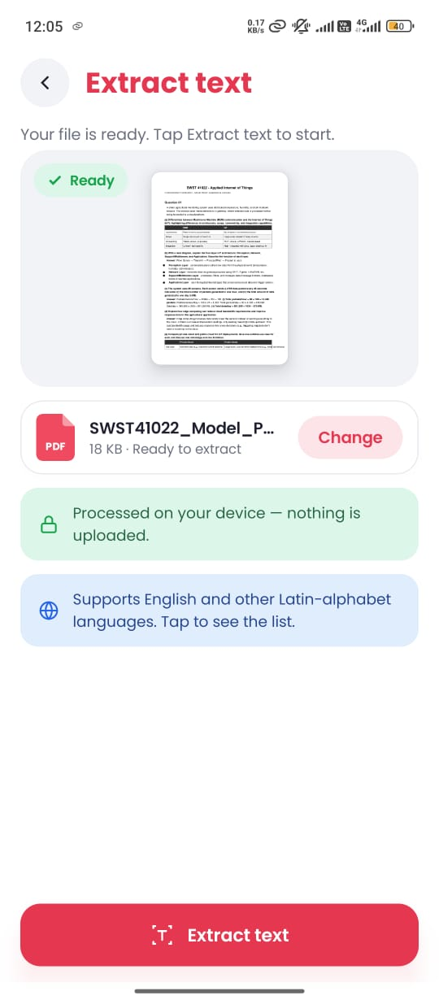<br /><sub>Choose a file</sub></td>
    <td align="center" width="33%">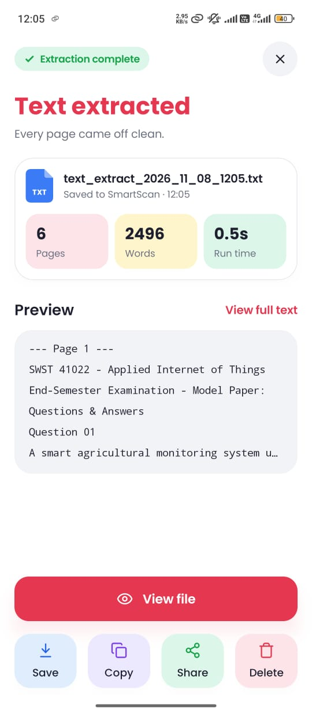<br /><sub>See the result</sub></td>
    <td align="center" width="33%">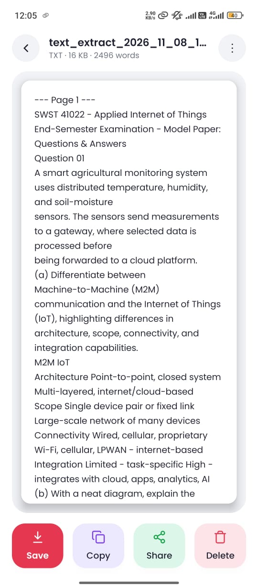<br /><sub>Read the text</sub></td>
  </tr>
</table>

### Image to PDF and PDF to image

Page size can be Original, A4 or Letter, and quality can be Small, Medium or Large.

<table>
  <tr>
    <td align="center" width="33%">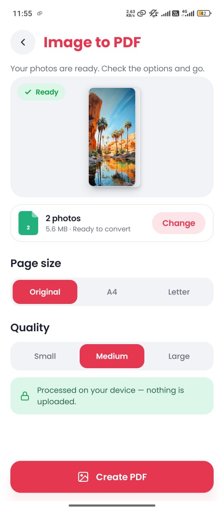<br /><sub>Image to PDF: set the options</sub></td>
    <td align="center" width="33%">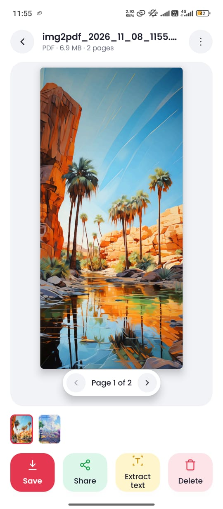<br /><sub>Image to PDF: open the result</sub></td>
    <td align="center" width="33%">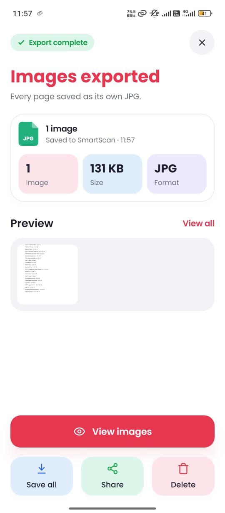<br /><sub>PDF to image: export the pages</sub></td>
  </tr>
</table>

### Merge and split

Drag files to set the merge order, adding them from the device or from earlier scans. To split, pick pages from a thumbnail grid.

<table>
  <tr>
    <td align="center" width="25%">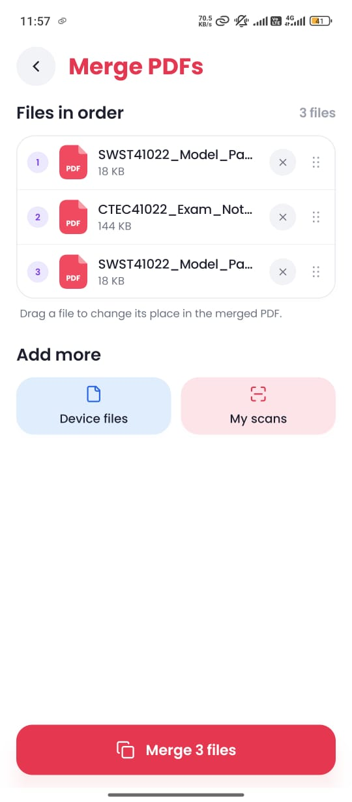<br /><sub>Merge: put files in order</sub></td>
    <td align="center" width="25%">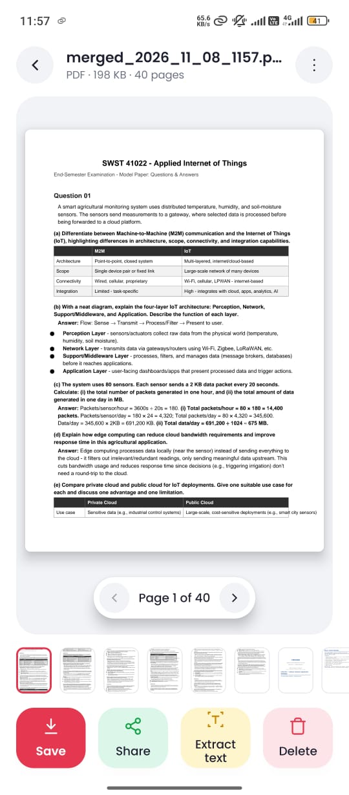<br /><sub>Merge: a 40-page result</sub></td>
    <td align="center" width="25%">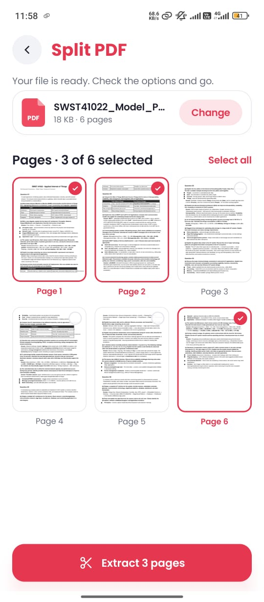<br /><sub>Split: pick the pages</sub></td>
    <td align="center" width="25%">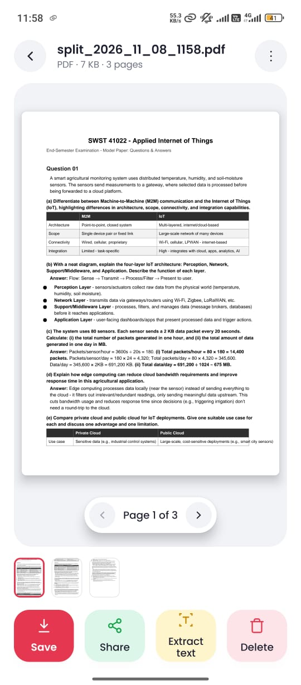<br /><sub>Split: the new PDF</sub></td>
  </tr>
</table>

---

## Files, settings and themes

- **My files**: search documents and filter by PDF, image or text.
- **Built-in viewer** for PDFs, images and text, with page thumbnails, **pinch to zoom** and double-tap zoom.
- **"Open with SmartScan"**: open any PDF or image from your Files or Gallery app, or share it to SmartScan.
- **One-tap actions**: save to Downloads, share, extract text, split and merge, right from the viewer.
- **Settings**: dark mode, on-device storage use, default save location, and deleting all files.

<table>
  <tr>
    <td align="center" width="25%">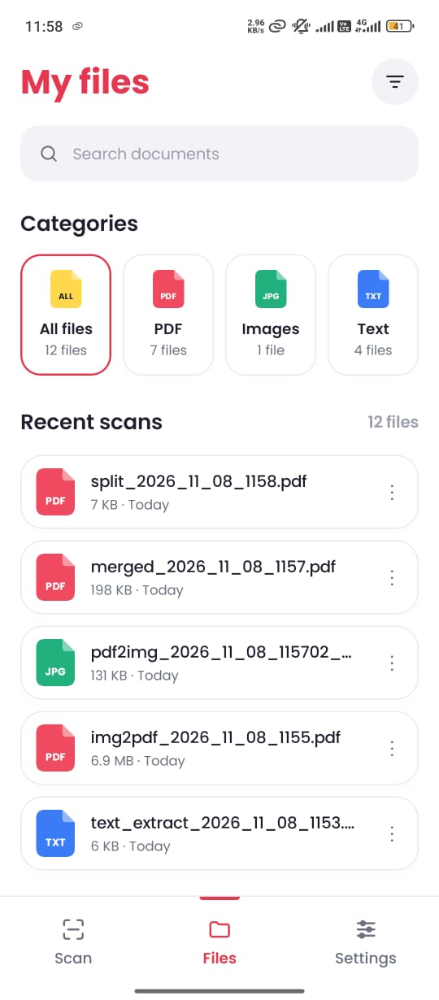<br /><sub>My files, light</sub></td>
    <td align="center" width="25%">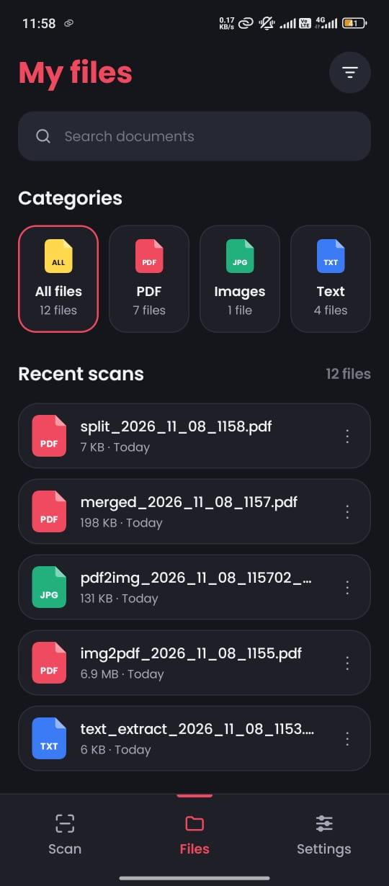<br /><sub>My files, dark</sub></td>
    <td align="center" width="25%">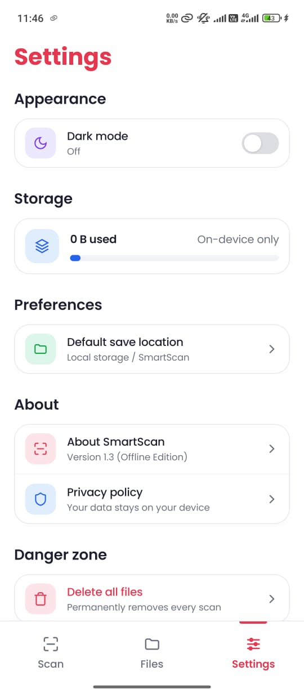<br /><sub>Settings, light</sub></td>
    <td align="center" width="25%">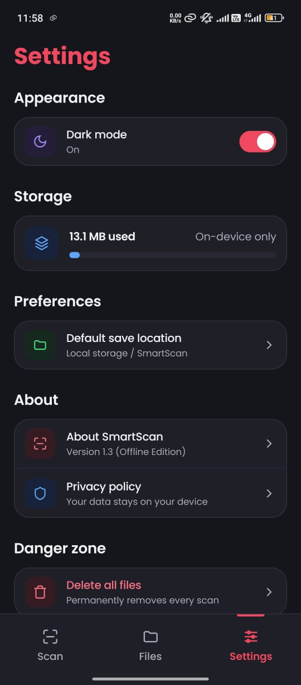<br /><sub>Settings, dark</sub></td>
  </tr>
</table>

---

## Privacy by design

SmartScan hands each sensitive job to a system component, so it never has to show a permission prompt.

| Job | Handled by | Permission prompt |
|---|---|---|
| Using the camera | ML Kit Document Scanner (system UI) | None |
| Opening files | System file picker | None |
| Saving exports | MediaStore | None |
| Sharing files | FileProvider | None |

**The trade-off:** the scanner comes through Google Play services, so scanning depends on them being on the device.

---

## Engineering Highlights

### Reading-order text extraction

ML Kit returns text blocks in detection order, which scrambles multi-column pages and tables. SmartScan reorders the blocks with a recursive **XY-cut**: it splits the page into horizontal bands, then into columns, and repeats. Each column is read top to bottom before moving to the next.

```text
Detected order             After XY-cut
┌──────────────────┐       ┌──────────────────┐
│        2         │       │        1         │  band
├────────┬─────────┤       ├────────┬─────────┤
│   5    │    1    │       │   2    │    5    │
│   3    │    6    │  -->  │   3    │    6    │  columns
│   7    │    4    │       │   4    │    7    │
├────────┴─────────┤       ├────────┴─────────┤
│        8         │       │        8         │  band
└──────────────────┘       └──────────────────┘
```

<sub>Illustration of the algorithm, not captured app data.</sub>

### Other highlights

- **Memory-friendly PDF viewing.** The app renders only small thumbnails for the page strip. Full-resolution pages are drawn on demand, one at a time, so a 100-page PDF never sits in memory all at once.
- **Gesture-aware zoom.** A custom pinch, pan and double-tap zoom container works inside a swipeable pager. At 1× a swipe turns the page. Once you zoom in, the same drag pans the page instead.
- **Intent handling.** The app handles `ACTION_VIEW` and `ACTION_SEND` for PDFs and images, and opens them in a standalone viewer with its own back behaviour.
- **Edge-to-edge on every device**, including older phones that use 3-button navigation.

---

## Tech Stack

| Area | Technology |
|---|---|
| Language | Kotlin, Coroutines, Flow |
| UI | Jetpack Compose, Material 3, a custom "Paper" design system, light and dark themes |
| Architecture | MVVM (ViewModel + StateFlow), single-activity app with Navigation Compose |
| Scanning | ML Kit Document Scanner (Google Play services) |
| Text recognition | ML Kit Text Recognition |
| PDF processing | PdfBox-Android (merge, split, watermark), Android `PdfRenderer` (rendering) |
| Storage | App-private storage, MediaStore (exports), FileProvider (sharing), DataStore (preferences) |
| Platform | Min SDK 29 (Android 10), target SDK 36, edge-to-edge UI, splash screen API |

---

## Architecture

```
app/
├── MainActivity.kt          # Single activity: theme, splash, incoming "Open with" intents
├── navigation/              # Navigation Compose graph and routes
├── ui/
│   ├── screens/             # Home, Files, Settings, tools, viewers, result pages
│   ├── components/          # Reusable "Paper" design-system components
│   ├── theme/               # Colors, typography, light and dark palettes
│   └── icons/               # Custom vector icon set
├── viewmodel/               # Screen state and business logic (StateFlow)
├── storage/                 # FileManager: save, compress, merge, split, render
└── utils/                   # Text recognition, page rendering, sharing helpers
```

---

## Version History

| Version | Highlights |
|---|---|
| **1.3** | "Open with" and Share support, text extraction in the image viewer, pinch-to-zoom viewer, clearer names |
| **1.2** | Image compression, 3-button navigation fix, supported-languages list |
| **1.1** | Minimum supported version lowered to Android 10 |
| **1.0** | First release: scanner and six document tools |

---

## Author

**Channa Bandara**, Android developer

<sub>This repository is a project showcase. The app's source code is not included.</sub>
